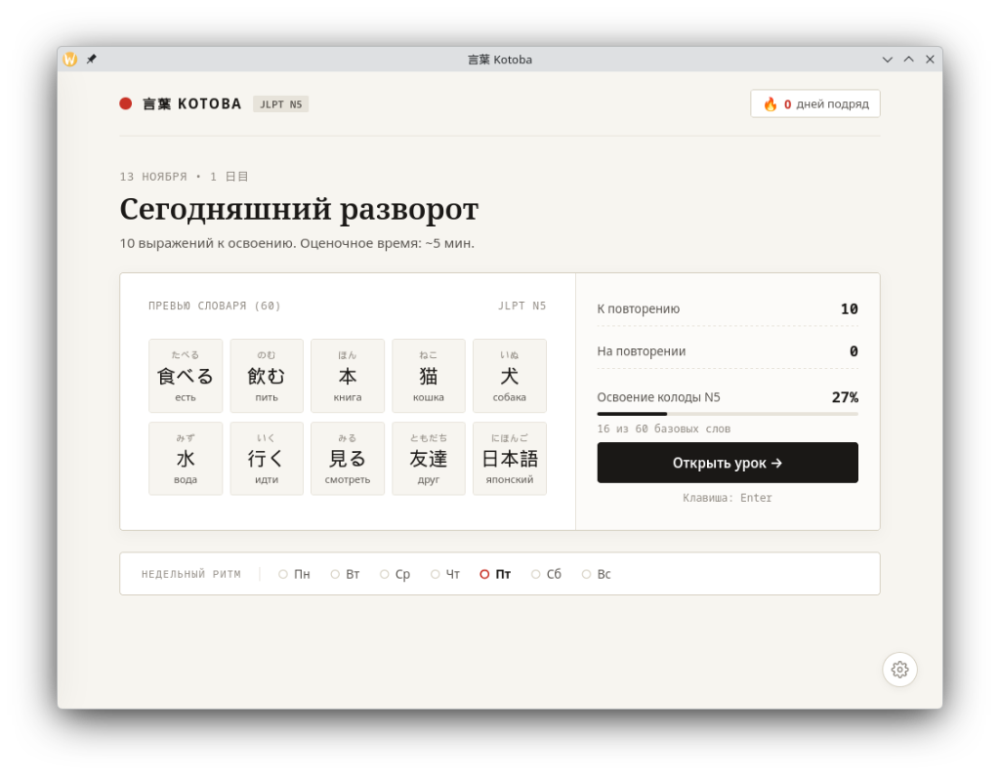

<div align="center">

# 言葉 Kotoba

**A keyboard-driven Japanese spaced repetition desktop app built with Tauri v2, Rust, and Svelte 5.**

[](https://github.com/SkavengC3/kotoba/releases)
[](https://tauri.app/)
[](LICENSE)

<br>



</div>

---

Kotoba is a local-first vocabulary and grammar study tool designed for daily JLPT preparation. Its interface takes cues from Japanese stationery and editorial print—warm washi paper (`#F7F5F0`), sumi ink (`#1A1816`), and vermilion seal accents (`#C83226`)—strip-mined of visual clutter so you can run an entire daily session without touching the mouse.

> **Scope note (`v0.1.0`):** Ships with a curated starter deck of 60 JLPT N5 cards and 17 grammar notes. Translations, UI copy, and grammar explanations are currently in Russian.

---

## Core Capabilities

- **Rust SRS Engine & SQLite Persistence**
  Interval scheduling (`Schedule::recalculate`), repetition queues, daily quota enforcement, and 7-day activity streaks run natively in Rust (`src-tauri/src/lib.rs`) and persist directly to a local SQLite database (`kotoba.db`) via bundled `rusqlite`.
- **Zero-Latency Offline Audio**
  All 60 vocabulary cards include pre-generated Tokyo-standard pronunciations (`static/audio/{id}.mp3`, 720 KB total, generated with `ja-JP-NanamiNeural` via `scripts/fetch_audio.py`). Audio plays automatically on card reveal or on demand with zero network calls.
- **Four Study Views**
  - **Daily Lesson:** Split flashcards displaying kanji and furigana on the front, revealing translation, contextual example sentence, and audio playback on flip.
  - **60s Blitz Sprint:** Timed rapid-recall mode sampling random cards from the deck.
  - **N5 Grammar Reference:** 17 concise notes covering particles, verb forms, and core patterns with live search and category filtering.
  - **Vocabulary Index:** Full card browser with filtering (`All`, `Learned`, `On Repeat`, `New`), sorting (`Order`, `Kana`, `Interval`), search across kanji/kana/translations/examples, and inline audio replay.

---

## Installation

Pre-built Linux binaries are published on the [Releases page](https://github.com/SkavengC3/kotoba/releases):

| Format | Target | Size | Install / Run |
| :--- | :--- | :--- | :--- |
| `.deb` | Debian / Ubuntu | 4.1 MB | `sudo dpkg -i Kotoba_0.1.0_amd64.deb` |
| `.rpm` | Fedora / RHEL | 4.1 MB | `sudo rpm -i Kotoba-0.1.0-1.x86_64.rpm` |
| `.AppImage` | Any Linux distro | 112 MB | `chmod +x Kotoba_0.1.0_amd64.AppImage && ./Kotoba_0.1.0_amd64.AppImage` |

*Native `.deb` and `.rpm` packages link dynamically against your system's `WebKitGTK` runtime (~4 MB); the `.AppImage` bundles GTK/WebKit runtimes internally for portability.*

---

## Keyboard Controls

| Context | Key | Action |
| :--- | :--- | :--- |
| **Global** | `Esc` | Return to dashboard |
| **Dashboard** | `Enter` | Start today's lesson |
| **Lesson (front)** | `Space` / `Enter` | Flip card and play audio |
| **Lesson (revealed)** | `1` / `2` / `3` | Grade recall (`Repeat` / `Difficult` / `Instantly`) |
| **Lesson (any state)** | `R` (or `К`) | Replay pronunciation audio |
| **Blitz (idle)** | `Enter` / `Space` | Start 60-second sprint |
| **Blitz (active)** | `1` / `Enter` / `Space` | Mark known (+1) |
| **Blitz (active)** | `2` / `→` | Skip card |

---

## Architecture

```text
kotoba/
├── src/
│   ├── lib/
│   │   ├── audio.ts          # Singleton HTMLAudioElement player for /audio/{id}.mp3
│   │   └── grammar.ts        # Structured JLPT N5 grammar rules & examples
│   └── routes/+page.svelte   # Svelte 5 frontend UI & keyboard controller
├── src-tauri/
│   ├── n5_vocab.tsv          # Default 60-card JLPT N5 corpus (embedded at compile time)
│   └── src/
│       ├── lib.rs            # Tauri IPC commands, CardDeck state, SRS interval logic
│       ├── db.rs             # SQLite schema, migrations, seeding, activity log
│       ├── parser.rs         # TSV deck parser
│       └── structs.rs        # Shared serde types (Card, Schedule, UserProgress)
├── scripts/
│   └── fetch_audio.py        # Reproducible Edge TTS batch audio generator
└── static/audio/             # Pre-bundled MP3 audio assets (1.mp3 .. 60.mp3)
```

---

## Building from Source

### Prerequisites

- **Rust** (Edition 2024 / Cargo 1.85+)
- **Node.js** (v18+) & `npm`
- **Linux system headers for Tauri v2:**
  - Fedora / RHEL:
    ```bash
    sudo dnf install webkit2gtk4.1-devel gtk3-devel librsvg2-devel libayatana-appindicator-gtk3-devel
    ```
  - Debian / Ubuntu:
    ```bash
    sudo apt install libwebkit2gtk-4.1-dev libgtk-3-dev librsvg2-dev libayatana-appindicator3-dev
    ```

### Commands

```bash
git clone https://github.com/SkavengC3/kotoba.git
cd kotoba
npm install

# Run in development mode with hot reload
npm run tauri dev

# Compile optimized release binary & native installers
npm run tauri build
```

TypeScript & Svelte checks can be run independently via `npm run check`.

*(Optional)* To regenerate the MP3 assets after modifying `src-tauri/n5_vocab.tsv`:

```bash
pip install edge-tts
python3 scripts/fetch_audio.py
```

---

## Roadmap

- [ ] Expand built-in vocabulary deck beyond the initial 60 N5 words
- [ ] External `.json` / `.tsv` deck import from the Settings screen
- [ ] Full UI and card translation localization (English / multilingual switching is currently stubbed in settings persistence)
- [ ] Automated Windows (`.msi` / `.exe`) builds via GitHub Actions

---

## License

MIT
